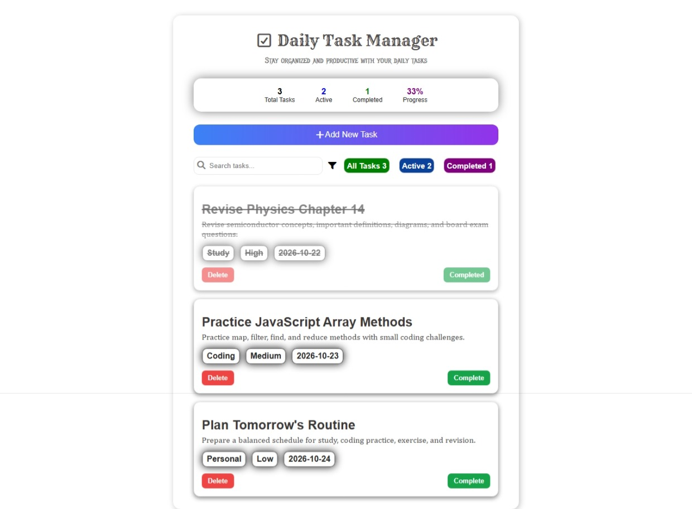

# Daily Task Manager
-  A simple daily task manager project built using HTML, CSS and JavaScript. This is very useful project because this project will use in everyday life.

---

## Features

- Add Daily Task 
- Form functionality
- Scores & Progress
- Search Section 

---

## Screenshot

---

## 🚀 Live Demo

🔗 **[View Live Demo](https://heyrohitdev.github.io/web-development-project/15-Daily-Task-Manager/)**

---

## 🛠️ Technology Used

* 🌐 HTML
* 🎨 CSS
* ⚡ JavaScript

---

## Purpose

- Practice JavaScript core topics
- Strong JavaScript thinking
- Improve HTML & CSS
- 
